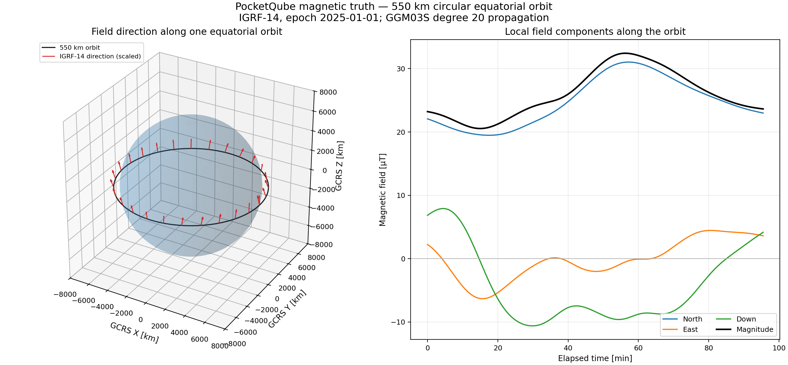
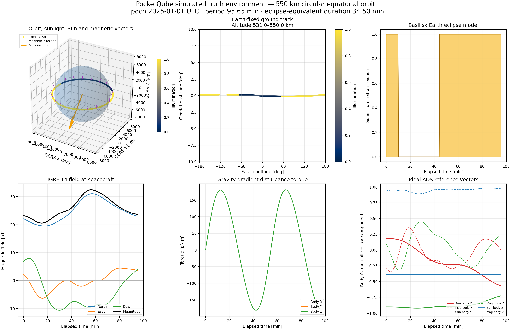
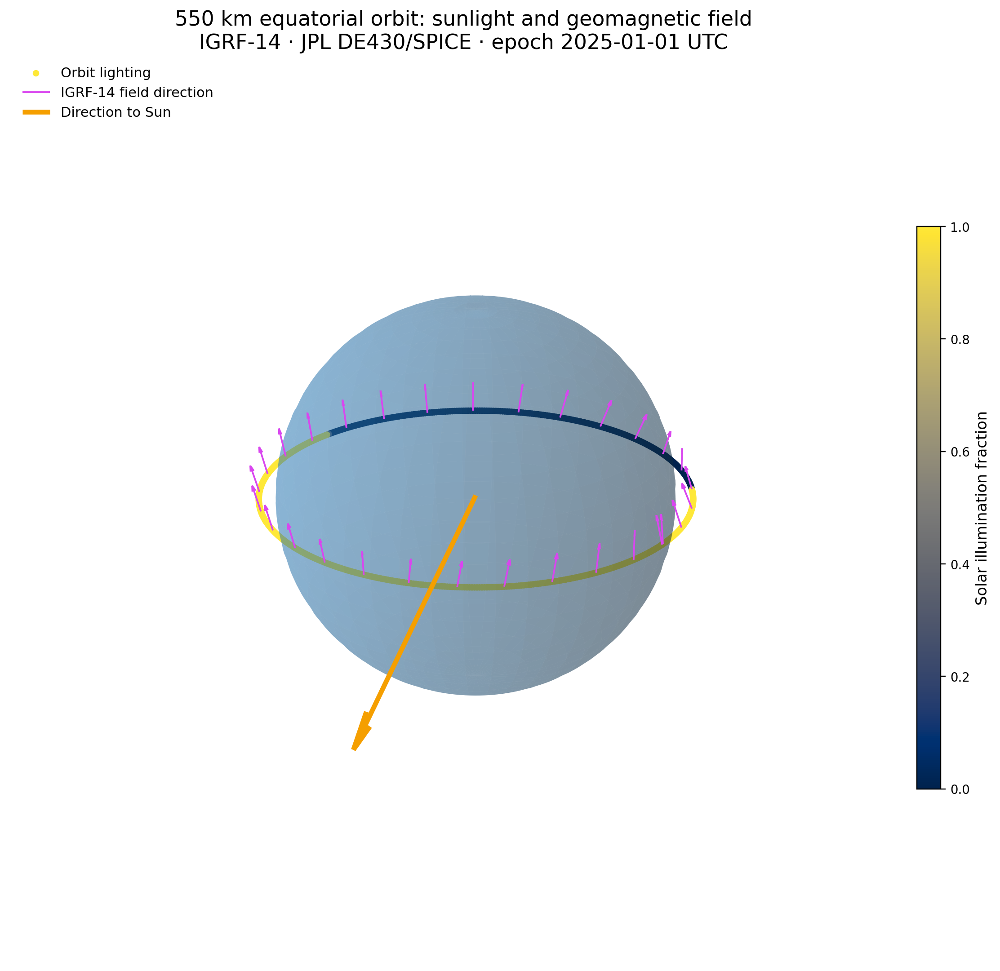

# PocketADCS Attitude Determination Simulation

A Python simulation environment for evaluating the attitude determination system (ADS)
of a PocketQube equipped with:

- a three-axis magnetometer
- a three-axis gyroscope
- a sun sensor

The mission question is whether that hardware can point a selected body axis at a
specified target on Earth. This repository is an **integration and verification
harness**: mission physics comes from established, vetted libraries, and project-owned
code only configures those models and defines the sensor and flight-software
interfaces.

## Quick start

Python 3.12 and [`uv`](https://docs.astral.sh/uv/) give a reproducible environment.

```bash
uv sync
uv run pytest
```

Run the integrated truth environment:

```bash
uv run python examples/run_truth_environment.py
```

Regenerate the reference plots:

```bash
uv run python examples/plot_magnetic_field_orbit.py
```

## What the simulation does today

| Capability | Implementation |
|---|---|
| Earth targets and pointing geometry | Astropy WGS84 geodesy, GCRS/ITRS transformations, PyMap3D azimuth/elevation/visibility |
| Orbit and rigid-body truth dynamics | Basilisk 6-DOF spacecraft propagation with configurable GGM03S spherical-harmonic Earth gravity |
| Sun, eclipse, and Earth orientation | JPL DE430/SPICE ephemeris, Basilisk eclipse model, Astropy IERS |
| Geomagnetic field | Official IGRF-14 (`ppigrf`) evaluated in ITRS, GCRS, and spacecraft body frames |
| Sun direction | Sun vector in GCRS and spacecraft body frames |
| Disturbance torque | Basilisk gravity-gradient torque |
| Configuration and outputs | Typed SI-unit configuration, time-correlated truth histories |

## Reference plots







## Project structure

```
src/pocketadcs_sim/    simulation and ADS package
  geometry.py          Earth targets, line of sight, visibility
  dynamics.py          Basilisk adapter for orbit and attitude propagation
  truth_environment.py integrated orbit, Sun/eclipse, IGRF-14, and torque
tests/               automated tests
examples/            executable simulation scenarios and plots
docs/              model assumptions, architecture, requirements
```

## Quality gates

```bash
uv run pytest         # tests
uv run ruff check .   # linting
uv run mypy src       # strict type checking
```

## Verification policy

Model and data versions are pinned in `uv.lock`; frame, epoch, units, and quaternion
convention are recorded at every interface; each library integration is checked against
an independent published reference value; and truth models are kept separate from the
flight-software model to avoid common-mode errors. See
[docs/architecture.md](docs/architecture.md) for the reuse boundary and
[docs/simulation-requirements.md](docs/simulation-requirements.md) for requirements.

## Status

Implemented: frames and geometry, truth orbit and attitude propagation, and the Sun,
eclipse, and geomagnetic environment. Remaining under the staged plan: sensor error
models, the attitude determination algorithm, pointing guidance and actuator dynamics,
navigation experiments, and Monte Carlo campaigns.
