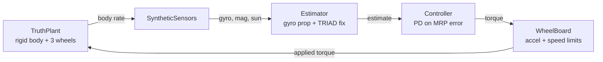
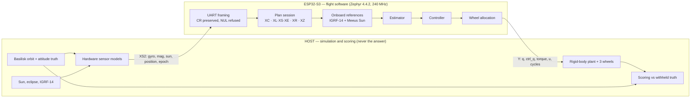
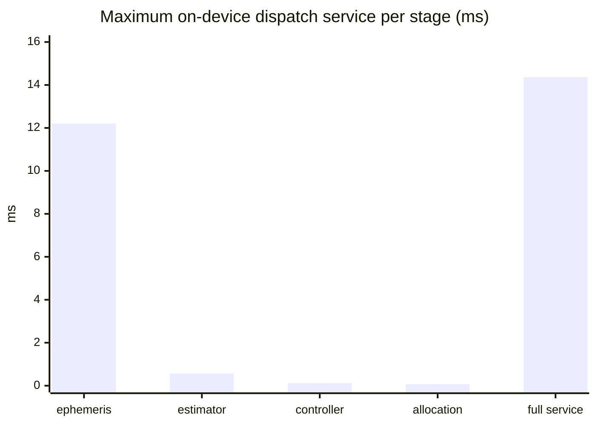

# PocketADCS — attitude determination, guidance and control

Can a magnetometer, gyroscope and sun sensor on a PocketQube-class satellite
point a chosen body axis at a ground target, and does that loop fit on a
microcontroller?

## Results

The approved image `a1218da3…` runs on the ESP32-S3 and holds sub-0.1° pointing
over 71,644 hardware frames with no dropped frames and no manual resets.

| Hardware mission | Frames | Final pointing error | Max device service |
|---|---:|---:|---:|
| Complete SlewOS schedule (2681.97 s) | 53,641 | **0.028462°** | 13.944 ms |
| Nontrivial 3-D maneuver (300 s) | 6,001 | **0.007558°** | 14.369 ms |
| Gyro-only eclipse (300 s) | 6,001 | **0.007558°** | 13.952 ms |
| Biased/noisy sensors (300 s) | 6,001 | 1.010198° | 13.955 ms |

- **0 drops, 0 overflows, 0 reboots, 0 manual resets.** Sixteen lifecycle and
  fault stimuli pass, including deliberate burst overload.
- **14.369 ms** worst-case on-device service against a 50 ms budget for 20 Hz;
  **5,084 bytes** minimum stack headroom.
- On the PC the same loop tracks a real FA01/SlewOS plan to **0.0270°** and an
  externally supplied 3-D profile to **0.0064°**.
- The biased case is a diagnostic, not a nominal pass: it matches the accepted
  baseline and is reported as such.

The host never sends the answer. It streams only what a vehicle knows about
itself — its sensor readings, its position, its clock — and the ESP32 derives the
Sun and geomagnetic reference vectors itself.

## Quick start

```bash
uv sync --locked
uv run pytest && uv run ruff check . && uv run mypy src
```

```bash
# PC closed loop
PYTHONPATH=src .venv/Scripts/python.exe examples/closed_loop_adcs.py
PYTHONPATH=src .venv/Scripts/python.exe examples/validate_plant_vs_basilisk.py

# ESP32-S3 (COM5)
bash esp32/build_zephyr.sh && bash esp32/flash_zephyr.sh COM5
PYTHONPATH=src .venv/Scripts/python.exe -m examples.hil_closed_loop_run \
  --port COM5 --output-dir results/hil_hardware/new_run --duration 300
```

Harness exit code is the verdict: `0` pass, `2` check failed, `1` could not run.
Write results to a fresh versioned directory; the stores are append-only.

---

# Design

## Truth simulation

| Capability | Source |
|---|---|
| Orbit, 6-DOF attitude, gravity-gradient torque | Basilisk 6-DOF, GGM03S |
| Earth targets, GCRS/ITRS frames, geodesy | Astropy/ERFA, pymap3d |
| Sun, eclipse, Earth orientation | JPL DE430/SPICE, Astropy IERS |
| Geomagnetic field | Official IGRF-14 (`ppigrf`) |

Truth and flight-software models are kept structurally separate so a shared
mistake cannot hide in both. Truth lives only on the host scoring path.

## PC closed-loop ADCS



The truth boundary is enforced by interface, then *measured*: the controller's
own recorded argument is compared against plant truth every step, and a test
rotates every fix by a known 10°. The vehicle then settles 10° off target, which
only happens if the loop is closed through the estimate.

The plant is cross-checked against Basilisk's own `ReactionWheelStateEffector`
(`max |domega| = 1.5e-05 rad/s`); the residual wheel-speed difference is
Basilisk's first-order rotor discretisation, not this plant's.

Details: [docs/adcs_closed_loop.md](docs/adcs_closed_loop.md)

## System design



No frame field can carry a reference vector, a true attitude or a true rate. The
plant stays on the host because rotational dynamics is not an ADCS function.

The reply carries both the reported attitude `q` and the attitude the controller
used `ctrl_q`. They must match, and reporting them separately makes a
control-path truth leak visible instead of assumed away.

## Modelled hardware

Every datasheet is vendored in [`docs/datasheets/`](docs/datasheets/README.md)
with sizes and SHA-256 digests.

| Function | Part | Model | Datasheet |
|---|---|---|---|
| Gyro / accelerometer | TDK ICM-40609-D | `sensors/icm40609d.py` | [DS-000330 Rev 1.2](docs/datasheets/icm-40609-d_ds-000330_v1.2.pdf) |
| Magnetometer | MEMSIC MMC5983MA | `sensors/hardware_models.py` | [Rev A](docs/datasheets/MMC5983MADatasheetRevA.pdf) |
| Sun sensor ×6 | Vishay VEMD8080 | `sensors/vemd8080_array.py` | [84565 Rev 1.1](docs/datasheets/vemd8080.pdf) |
| Reaction wheels ×3 | TGR 29-12 | `adcs/rotors.py` | [Rev B](docs/datasheets/TGR-29-12-Datasheet-Rev-B.pdf) |
| Flight computer | Waveshare ESP32-S3 | `esp32/zephyr/` | Espressif TRM |

Each model runs a documented chain: bias and flicker drift, noise given as a
**density** converted to per-sample sigma from the equivalent noise bandwidth,
full-scale saturation, quantization to the part's code grid, dequantization.

| Part | Quantity | Value | Provenance |
|---|---|---|---|
| ICM-40609-D | gyro FSR / noise | ±2000 dps; 4.5 mdps/√Hz | datasheet |
| MMC5983MA | range / sensitivity | ±8 G; 4096 counts/G | datasheet |
| VEMD8080 | half-sensitivity angle | ±65° | datasheet |
| TGR 29-12 | inertia / max speed | 3.27e-6 kg·m²; 1675.5 rad/s | datasheet |
| TGR 29-12 | continuous torque (vacuum) | 0.0028 N·m | datasheet |
| TGR 29-12 | acceleration cap | 200 rad/s² | **engineering assumption** |

The acceleration cap is the one exception: no stall torque or speed-torque curve
is published, so it is an assumption (~23% of the torque-implied maximum) and
tests fail if that flag is flipped.

Notes: [MMC5983MA](docs/hardware_sensor_models.md) ·
[ICM-40609-D](docs/icm40609d.md) · [VEMD8080 array](docs/vemd8080_array.md)

## Firmware

`esp32/src/` holds the flight software as portable headers compiled by both the
host test toolchain and the target, so the tested code ships. The legacy
stateless `S2`/`R` exchange is unchanged; closed loop is a separate versioned
family (`XS2`/`Y`).

`XC`, `XL`/`XS`/`XE` and `XR`/`XE` are live updates that preserve estimator time
and wheel momentum. `XZ` is the only fresh-mission boundary, acknowledged exactly
`E XZ 0 -1 0`; it clears mission state in place without rebooting and preserves
configuration and cumulative health.

| Situation | Behaviour | Prevents |
|---|---|---|
| No absolute fix | torque 0, status reports it | acting on a guess |
| Stale sample gap | do not propagate, torque 0 | integrating 30 s of stale gyro |
| Eclipse (zero sun) | reject fix, keep last | a fix on an undefined direction |
| Over-long line | refuse whole | truncation parsing as a valid frame |
| `XE` segment mismatch | refuse, keep plan | a half-applied schedule |
| At speed/accel bound | clamp increment, not command | exceeding a rotor limit |

Rotor momentum is preserved across a suppressed cycle, never zeroed.

Framing rejects NUL, non-ASCII and control bytes while **preserving CR as a
separator**: `X\rZ` is not `XZ`, `.3\r5` is not `.35`. The 16 KiB main stack comes
from an Xtensa `-fstack-usage` audit finding ≥9,488 bytes in the ephemeris chain
alone.

Details: [docs/esp32_closed_loop.md](docs/esp32_closed_loop.md)

---

# Results detail

## On-device service time

Maximum over all 71,644 frames, from the target's cycle counter at its validated
240 MHz identity:



Full service is not the sum of the stages: it also covers parsing, profile
evaluation and reply formatting, and it includes preemption inside the dispatch.
It excludes ISR framing, queue wait and transport, and is not host round-trip
latency.

## Reliability findings

| Symptom | Root cause | Correction |
|---|---|---|
| Silent after a verified flash | ESP32-S3 USB retained the download-mode strap | documented `--after watchdog-reset` |
| Needed a manual reset | 4 KiB stack vs ≥9,488-byte ephemeris chain | 16 KiB, audited with Xtensa `-fstack-usage` |
| 111 of 1201 replies | unbounded send overran the RX queue | 16-frame window; then 1201/1201 |
| All replies unparseable | 13-token reply vs 11-token parser | parser accepts exactly both shapes |
| ~0.35° Sun error | axes-of-date mislabelled GCRS; wrong-sign J2000 offset | corrected frame and epoch |

Failures are retained beside their fixes:
`standard_stream.jsonl` (failed) / `bounded_stream.jsonl` (passed), and the first
failed batch in `raw.jsonl` beside the 30 corrected ones. See
[docs/esp32_reliability.md](docs/esp32_reliability.md).

## Test suite

| Area | Coverage |
|---|---|
| Quaternions | propagation, non-commuting rates, 180° conditioning, MRP round trips |
| Rotors | datasheet values pinned by mutation; provenance flags cannot be flipped |
| Plant | momentum conservation, gyroscopic coupling, RK4 vs adaptive |
| Wheel board | accel cap, speed bound, braking while overspeed, timeout keeps state |
| Estimator | TRIAD fix, gyro-only drift, eclipse recovery, zero-vector rejection |
| Controller | error direction, damping, closed-loop sign pinned by convergence |
| SlewOS | real plan end-to-end, no fallback, every segment vs the planner's own timing |
| Closed loop | whole-maneuver tracking, 3-D target, eclipse, three truth-ownership tests |
| Differential | C++ core vs the PC prototype, value by value |
| Zephyr | real build, signed-image byte identity, raw ISR replays, resource budget |

## Scope

- Not flight qualification: sensors are synthetic, wheels are a host stand-in,
  and there is no sensed wheel speed.
- The FA01 planner is single-axis rest-to-rest; 3-D pointing uses an external
  profile, and the adapter refuses a multi-axis case rather than flattening it.
- Primary missions ran unpaced lockstep; wall-paced 20 Hz is shown over 30 s.
- Simulation is evidence, not proof — it must be correlated with bench,
  rate-table, Helmholtz-cage and thermal-vacuum tests.

---

**Layout:** `src/pocketadcs_sim/` simulation, sensors and ADCS ·
`esp32/src/` flight software · `esp32/zephyr/` target application ·
`examples/` scenarios and harnesses · `docs/` design notes and datasheets ·
`results/` versioned evidence.

Architecture and requirements: [docs/architecture.md](docs/architecture.md) ·
[docs/simulation-requirements.md](docs/simulation-requirements.md)
